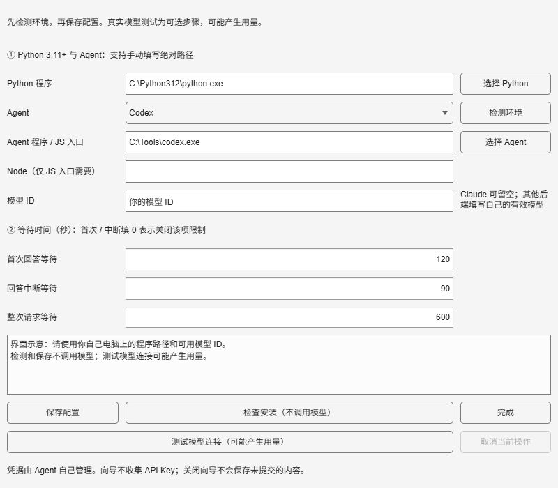

# MATLAB AI 助手

在 MATLAB 中提问、生成和修改代码。先看差异，再将修改写回编辑器。

支持当前文件、选中代码和未保存文档，也可以查询函数帮助、查看对话历史，以及对 Simulink 模型提出修改。

## 开始使用

**需要 Windows、MATLAB R2026a、Python 3.11+，以及已安装并配置好账户的 Agent CLI。**

1. 从 [Releases](https://github.com/yuyu-wu-feng/matlab-ai-bridge/releases) 下载 ZIP 并解压，或下载本仓库源码。
2. 在 MATLAB 中打开根目录的 `start_ai.m`，点击运行。
3. 首次配置向导中检测 Python 和 Agent，确认模型，保存配置。
4. 输入需求，例如“绘制 0 到 2π 的正弦曲线”，发送后查看代码，点击“新建代码文档”。

生成代码不会自动保存或运行。修改已有代码时，先打开 `.m` 文件，选择“修改”和目标范围，查看差异后再应用。



检测和安装检查不调用模型；“测试模型连接”会发送固定示例，可能产生用量。模型服务费用由自己的账户承担。

[安装与使用](docs/安装与使用.md) · [让自己的 AI 帮忙配置](AI_SETUP.md) · [功能与限制](docs/功能参考.md)

## 能做什么

- **生成、解释、修改和续写**：读取当前文件或选区，预览差异后应用；支持恢复上次修改。
- **连续提问与本地历史**：保留对话和代码版本，支持根据报错继续修改。
- **函数帮助**：查询本机帮助与工具箱信息，保留资料来源。
- **Simulink**：读取模型、预览支持的参数和连线修改、处理 MATLAB Function 代码。

应用前会重新检查目标内容，避免覆盖编辑期间的改动。Live Script、App Designer、多文件修改和自动执行暂不支持。

## Agent 支持

| Agent | 状态 |
| --- | --- |
| Codex CLI | 已验证真实模型请求及 MATLAB 编辑流程 |
| Claude Code | 已验证初始化和协议适配，尚未验证成功生成 |
| DeepSeek Harness | 实验性，尚未验证真实安装与模型请求 |

模型取决于所选 CLI 的账户和服务配置。通过 Codex 调用 DeepSeek 模型时，Agent 仍选 Codex。

在“后端与等待设置”中切换 Agent、模型和超时。新配置默认首次回答等待 120 秒、中断等待 90 秒、总等待 600 秒；都可以调整。

## 配置与数据

`config.local.json` 保存本机设置，`output/` 保存历史和运行输出。不要把这两个位置上传到仓库或发给别人。
凭据由 Agent 管理。所选代码和启用的对话上下文会发送给配置的模型服务。

重新检测环境：关闭助手，在 MATLAB 中运行 `matlab_ai_setup`，保存后重新运行 `start_ai.m`。

## 开发与验证

Python 后端仅使用标准库。在项目根目录运行：

```powershell
python -B -m unittest discover -s tests -q
```

已在 Windows + MATLAB R2026a Update 5 验证。其他系统和 MATLAB 版本尚未验证。
更多测试与打包方法见 [开发说明](docs/开发与验证.md)。

## 许可证

[MIT](LICENSE)
